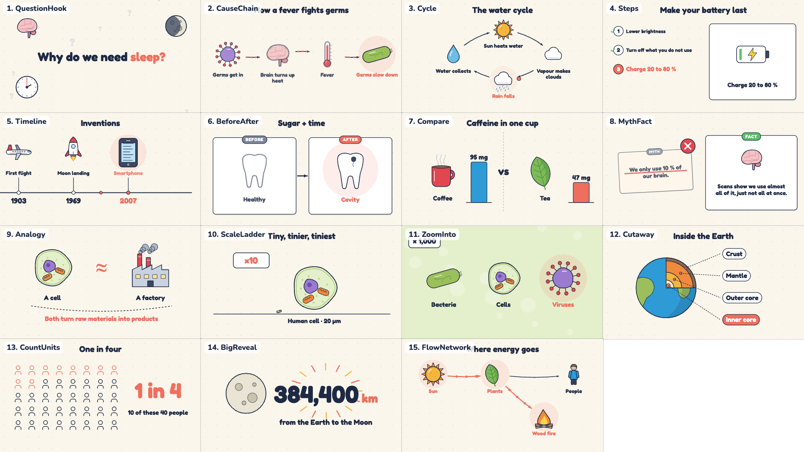
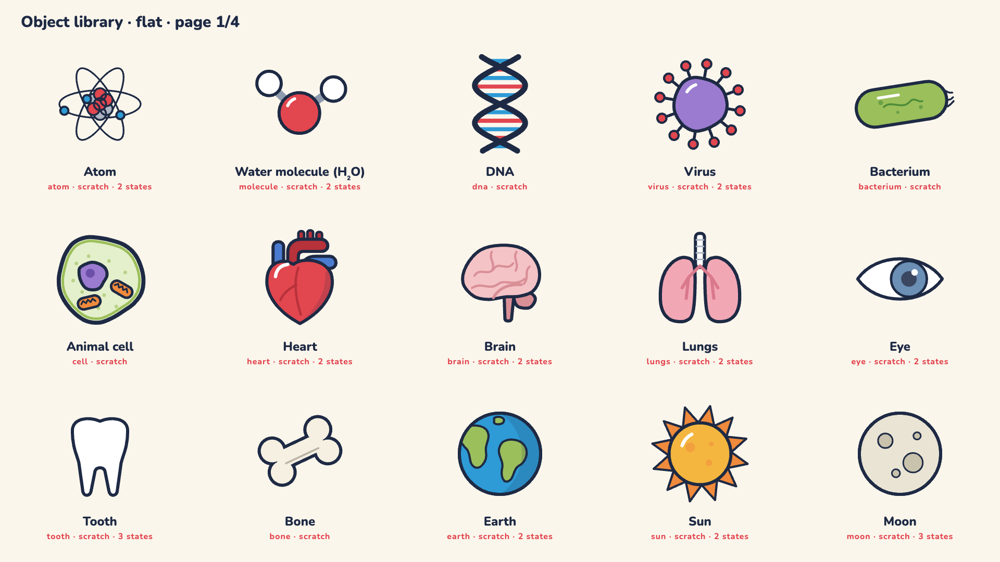

# Explainer Studio

A starter repository for short animated explainer videos (1–5 min, plus a 9:16 Short), made with an AI assistant:
script → local text-to-speech → word-timed animation in [Remotion](https://www.remotion.dev) → music, sound effects, mix → subtitles → thumbnails and upload text.

What is inside:

- **15 explanation patterns** — cause chain, cycle, steps, timeline, before/after, compare, myth/fact, analogy, scale ladder, zoom-into, cutaway, count units, big reveal, question hook, flow network. Each plays on word-timed beats and never leaves the screen empty or frozen.
- **An object library** — 50 animated objects (science, body, nature, tech, everyday, people) with states, plus all ~5,000 Tabler icons as pictograms, drawn in one style by two renderers: **flat** and **whiteboard** (live marker drawing). One switch in `brand.ts`.
- **A pacing scanner** — finds holds longer than 4 s and empty frames before you show the animatic.
- **The production pipeline** — local TTS, word alignment, music fitted on the beat, SFX, loudness mix, subtitles, thumbnails, 9:16 Short.

It comes from a real channel workflow and includes a working demo episode ("Why is the sky blue?", `ep000`) that runs without any images or music: characters are placeholder figures until you add images, and missing music is synthesized.





## Quick start

```bash
cd studio
bash scripts/setup.sh                       # Node packages, Python venv, TTS model (one time, ~400 MB)
npx remotion studio                         # open the demo, the patterns reel and the library pages in the browser
bash scripts/render-library.sh              # render the library catalogue + patterns reel on this computer -> docs/library/
bash scripts/voice.sh ep000                 # make the voice for the demo
bash scripts/animatic.sh ep000              # render the animatic (placeholder figures, voice, shot numbers)
bash scripts/final.sh ep000                 # final video: picture + music + SFX + mix + subtitles
bash scripts/publish.sh ep000               # thumbnails + 9:16 Short
```

Needs: macOS, Linux or Windows (WSL); Node 18+; ffmpeg; Python 3.10–3.12. Finished files go to the folders in `studio/config.sh` (`DELIVER_TO`), never to git.

## Make it yours

1. `studio/src/brand.ts` — channel name, tagline, colours, series, cast (or no cast for narrator-only).
2. `studio/public/brand/logo-mark.png`, `logo-horizontal.png` — optional; without them the name is drawn as a word mark.
3. `studio/voices.json` — one voice per speaker.
4. `docs/project-card.md` — answer the 6 questions; the AI reads this first.
5. Start an episode: copy `episodes/ep000-*` and `studio/src/episodes/ep000/`, or ask your AI: *"New episode: Why do cats purr?"*

## Working with an AI

`AGENTS.md` (and `CLAUDE.md`) tell any coding AI how to work here. The full method is in `docs/production-pipeline.md`, `docs/patterns.md` and `docs/objlib.md`; the same method as a portable skill is in `.claude/skills/explainer-video-studio/` and `.agents/skills/explainer-video-studio/`.

Use the skill outside this repo:

- **Claude Code**: copy `.claude/skills/explainer-video-studio/` to `~/.claude/skills/`.
- **Claude.ai / Claude desktop**: zip the `explainer-video-studio` folder (`bash scripts/pack-skill.sh` makes `dist/explainer-video-studio.zip`) and upload it under Settings → Capabilities → Skills.
- **Other agents** that read `.agents/skills/`: copy that folder.

## Layout

```
docs/                     project card, production pipeline (the source of truth), kit reference
brand/                    characters/library/ (pose images), locations/ (backgrounds), music/ (series music, not in git)
episodes/<ep>-<slug>/     script, research, lines.json, pauses.json, storyboard, assets list, sound.json, publish/
studio/                   Remotion project + scripts
  src/brand.ts            the brand, in one file
  src/kit/                reusable pieces: lib, chars, stage, science (infographics), bookends, thumb, short, animatic, cues
  src/episodes/<ep>/      Main.tsx (shots), timeline.json, words.json, publish/
  scripts/                setup, voice, animatic, final, publish, deliver, tts, timeline, align, sound, mix, subs, prep_assets, stills
```

## Licences

Code: MIT (`LICENSE`). Icons: Tabler Icons and Phosphor Icons, MIT (`LICENSES/`). Fonts in `studio/src/kit/fontcss.ts`: Fredoka, Roboto Slab and Nunito (SIL Open Font License). Kokoro TTS model: Apache 2.0 — check the licence of any other voice model before you publish.
